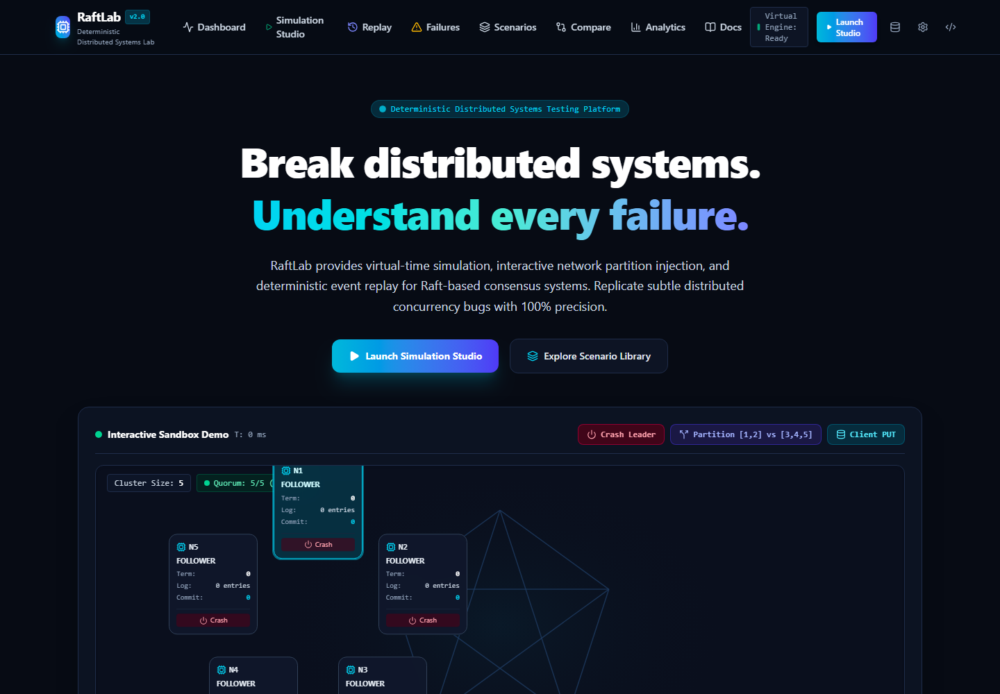
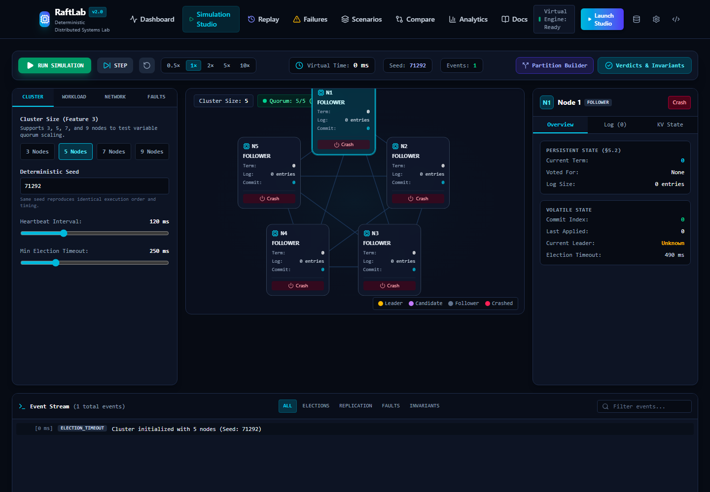
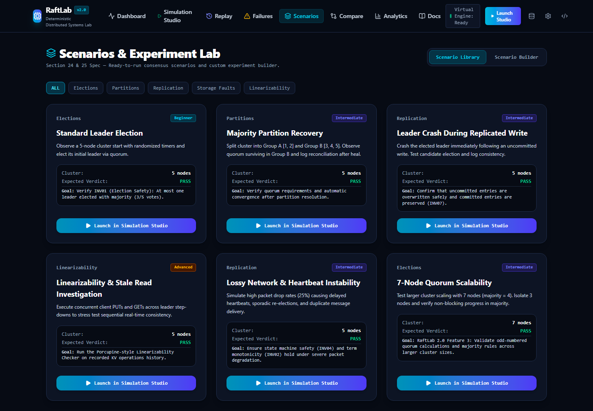
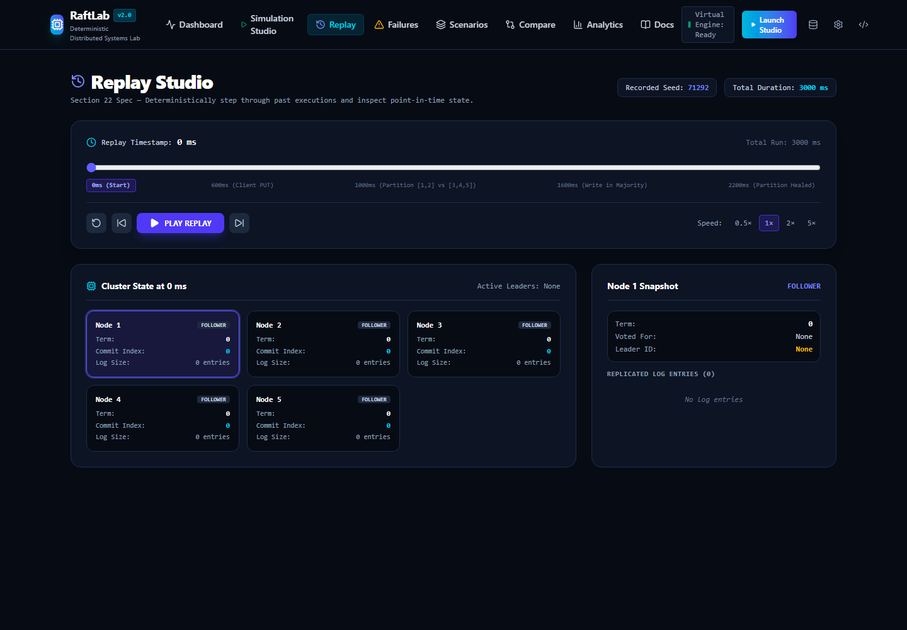
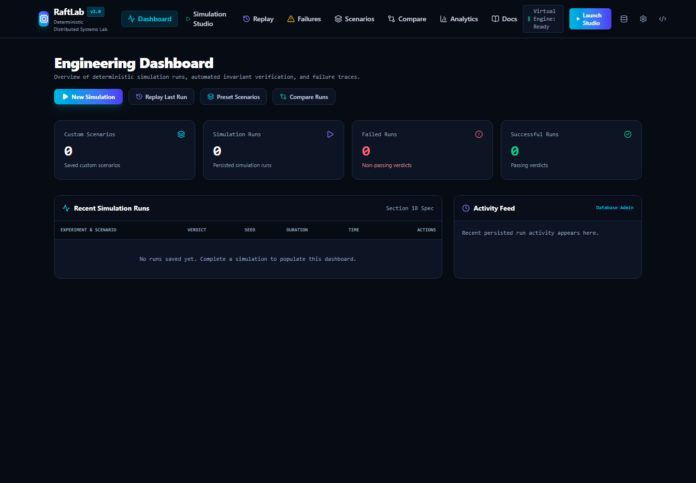
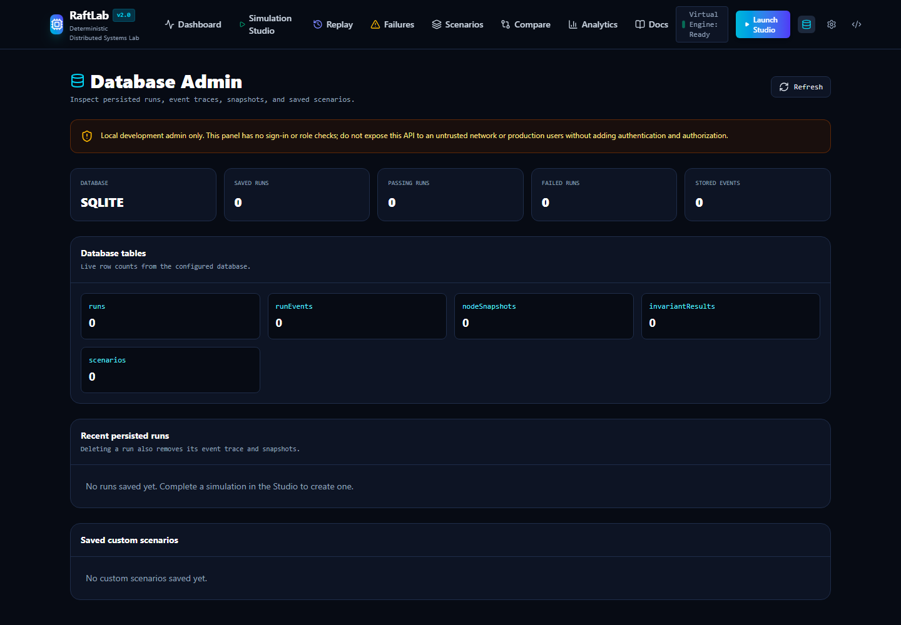

# RaftLab

**A deterministic distributed-systems lab for exploring Raft elections, network faults, replication, and failure traces.**

RaftLab combines an interactive Raft simulator with a React engineering workspace and a FastAPI persistence API. Configure a cluster, advance virtual time, introduce faults, inspect protocol events, check selected safety properties, and save completed traces for later replay.

> **Project status:** Local development MVP. The simulator currently runs in the browser; the API stores completed runs and custom scenarios. This is not a production-hosted service, and the admin API has no authentication.

## At a glance

- Simulate clusters of **3, 5, 7, or 9 nodes**.
- Use a deterministic seed and virtual clock to make runs repeatable.
- Inspect node roles, terms, votes, commit indexes, logs, packets, and events.
- Inject manual crashes, restarts, partitions, and partition heals.
- Submit `PUT`, `GET`, and `DELETE` client operations.
- Review invariant results and a run verdict.
- Persist runs, events, snapshots, invariant results, and custom scenarios in SQLite or PostgreSQL.
- Replay a saved run and inspect node snapshots over virtual time.
- Browse preset scenarios and save custom scenario definitions.

## Screenshots

Screenshots are real browser captures of the local application. The dashboard and admin images show a fresh database with no saved runs yet.

| Landing page and interactive cluster | Simulation Studio |
|---|---|
|  |  |

| Preset scenario library | Replay Studio |
|---|---|
|  |  |

| Dashboard | Database Admin |
|---|---|
|  |  |

## Product tour

### Landing page

An interactive five-node sandbox demonstrates the cluster topology. The page exposes controls to crash a leader, partition or heal the network, and submit a client write.

### Dashboard

The dashboard requests run and scenario counts, recent persisted runs, verdicts, seeds, and event totals from the API. It displays an explicit connection error if the API is unavailable.

### Simulation Studio

The main workspace includes:

- **Cluster configuration:** select 3, 5, 7, or 9 nodes; set a deterministic seed; adjust heartbeat and election timeout values.
- **Simulation controls:** start/pause, step virtual time, reset, and select playback speed.
- **Network configuration:** adjust latency, jitter, drop, duplicate, and reorder parameters.
- **Fault controls:** build a network partition, heal it, crash nodes, and restart crashed nodes.
- **Client workload:** submit `PUT`, `GET`, and `DELETE` operations to the active simulated cluster.
- **Visualization:** inspect a node topology, node state, and a filterable event stream.
- **Run results:** inspect a verdict and invariant results; completed runs are saved through the API, with retry feedback if persistence fails.

The browser simulator currently stops a continuously running simulation at 8,000 virtual milliseconds. Step-by-step runs can also be exported from the Studio's verdict controls.

### Replay Studio

Without a `runId` query parameter, Replay Studio opens a built-in demonstration trace. Select **Replay** on a saved dashboard run to load that run's snapshots and its first page of events. The trace endpoint supports pagination for clients that need additional events.

### Scenarios

The library includes preset election, partition recovery, leader crash, lossy network, variable-cluster, and linearizability scenarios. The builder stores custom scenario definitions, including the entered workload and fault schedule. At this MVP stage, saving a scenario does **not** automatically execute its schedule in the Simulation Studio.

### Other workspace pages

The app also includes **Failure Analysis**, **Compare**, **Analytics**, **Docs**, and **Settings** routes. They provide the existing front-end workspace and learning surfaces; not every page is backed by persisted API data yet.

### Database Admin

The Admin page reports live database row counts, lists runs and saved custom scenarios, and supports deletion. Removing a run cascades to its events, snapshots, and invariant-result records.

## Architecture

```text
React + TypeScript + Vite
        │
        ├── Browser-side deterministic Raft simulator
        │
        └── /api/v1 requests
                │
           FastAPI + Pydantic
                │
         SQLAlchemy ORM
                │
         SQLite (default) or PostgreSQL
```

### Frontend

- React 19, TypeScript, React Router, Vite 8, Tailwind CSS 4, and Lucide icons.
- The simulator implementation is in [`src/engine/raftSimulator.ts`](src/engine/raftSimulator.ts).
- Shared Raft types are in [`src/types/raft.ts`](src/types/raft.ts).
- API client functions are in [`src/api/raftLabApi.ts`](src/api/raftLabApi.ts).
- During local development Vite proxies `/api` to `http://127.0.0.1:8000`.

### Backend

- FastAPI, Pydantic, SQLAlchemy 2, and Uvicorn.
- SQLite is the local default; set `DATABASE_URL` to use PostgreSQL.
- Tables created by the current API: `runs`, `run_events`, `node_snapshots`, `invariant_results`, and `scenarios`.
- Events are stored with per-run sequence numbers and query indexes. Event reads are paginated.
- The current schema is initialized with SQLAlchemy `create_all`; Alembic migrations are not set up yet.

### Data flow

1. The browser simulator executes a run and builds a run record, event list, and snapshots.
2. The frontend submits the completed record to `POST /api/v1/runs`.
3. The API validates the run and stores metadata and its child event, snapshot, and invariant records.
4. The dashboard and admin page read persisted data from the API.
5. Replay loads a saved run's snapshots and pages through its events.

## Requirements

- Node.js compatible with Vite 8 (Node **20.19+** or **22.12+** recommended).
- npm.
- Python **3.10+**.
- PostgreSQL is optional; the default SQLite database requires no separate database service.

## Getting started on Windows

Open PowerShell in the project directory.

### 1. Install frontend dependencies

```powershell
npm install
```

### 2. Install backend dependencies

```powershell
python -m pip install -r backend/requirements.txt
```

### 3. Start the API

In the first terminal:

```powershell
npm run api
```

The API listens on `http://127.0.0.1:8000`. On first startup, it creates `backend/data/raftlab.db`.

### 4. Start the frontend

In a second terminal:

```powershell
npm run dev
```

Open [http://localhost:5173](http://localhost:5173). The Vite development server proxies API requests to the local backend.

### API health check

```powershell
Invoke-RestMethod http://127.0.0.1:8000/api/v1/health
```

Expected response:

```json
{
  "status": "ok",
  "database": "sqlite"
}
```

## Configuration

| Variable | Used by | Default | Description |
|---|---|---|---|
| `DATABASE_URL` | Backend | SQLite file at `backend/data/raftlab.db` | SQLAlchemy database URL. PostgreSQL uses the installed `psycopg` driver. |
| `RAFTLAB_CORS_ORIGINS` | Backend | `http://localhost:5173,http://127.0.0.1:5173` | Comma-separated allowed browser origins. |
| `VITE_API_BASE_URL` | Frontend build | Empty (same-origin `/api/v1`) | API origin when the frontend and API are hosted separately. |

Example PowerShell configuration for PostgreSQL:

```powershell
$env:DATABASE_URL = "postgresql+psycopg://localhost:5432/raftlab"
npm run api
```

If your PostgreSQL server requires credentials, configure them in your local environment without committing them. For local Vite development, keep using the proxy or set `VITE_API_BASE_URL` before building if the API is hosted at another origin.

## API reference

All routes are versioned under `/api/v1`.

| Method | Path | Purpose |
|---|---|---|
| `GET` | `/health` | Check API and database connectivity. |
| `GET` | `/admin/overview` | Read database table counts, verdict totals, and recent runs. |
| `GET` | `/runs?limit=20&offset=0` | List run summaries with pagination (`limit` 1–100). |
| `POST` | `/runs` | Persist a run, events, snapshots, and invariant results. |
| `GET` | `/runs/{run_id}` | Read run metadata, invariant results, and snapshots. |
| `DELETE` | `/runs/{run_id}` | Delete a run and its related records. |
| `GET` | `/runs/{run_id}/events?limit=100&offset=0` | Read a page of events (`limit` 1–500). |
| `GET` | `/scenarios` | List saved custom scenarios. |
| `POST` | `/scenarios` | Save a custom scenario definition. |
| `PATCH` | `/scenarios/{scenario_id}` | Replace/update a saved scenario definition. |
| `DELETE` | `/scenarios/{scenario_id}` | Delete a saved scenario. |

Run creation enforces supported cluster sizes (3, 5, 7, or 9), bounds event/snapshot counts and run duration, validates verdict values, and checks that the supplied `eventCount` matches the event list.

Interactive API documentation is available from FastAPI at [http://127.0.0.1:8000/docs](http://127.0.0.1:8000/docs) while the backend is running.

## Testing and build

Run the complete frontend and backend suites:

```powershell
npm test
```

The frontend test command uses Vitest, jsdom, and React Testing Library:

```powershell
npm run test:frontend
```

Install backend test dependencies and run the API tests:

```powershell
python -m pip install -r backend/requirements-dev.txt
npm run test:backend
```

Backend tests use an isolated temporary SQLite database; they do not write test records into the local development database.

Create a production frontend bundle:

```powershell
npm run build
```

## Project layout

```text
backend/
  main.py                 FastAPI app, SQLAlchemy models, and versioned API
  requirements.txt        Runtime dependencies
  requirements-dev.txt    Test dependencies
  tests/
    conftest.py           Isolated test database and API client
    test_api.py           Backend endpoint and persistence tests
src/
  api/
    raftLabApi.ts         Typed frontend API client
    raftLabApi.test.ts    API client tests
  components/             Cluster, event stream, inspector, and modals
  data/scenarios.ts       Built-in scenario definitions
  engine/raftSimulator.ts Browser-side deterministic Raft simulator
  pages/                  Application routes and page-level tests
  types/raft.ts           Simulation, event, scenario, and run types
docs/
  screenshots/            README UI screenshots
```

## Current scope and known limitations

- Simulation execution and verdict calculation happen in the browser. The backend persists results but does not run simulations in background workers.
- There is no account system, project ownership, role-based access, or authentication.
- The Admin page and write/delete API routes are development tools. Do not expose the API to untrusted networks or users.
- Scenario definitions can be saved and listed, but schedules are not yet translated into an automated Studio run.
- Failure Analysis, Compare, Analytics, and Settings are not fully backed by persistent server data.
- The simulator currently checks Election Safety (`INV01`), Term Monotonicity (`INV02`), Commit Index Monotonicity (`INV03`), State Machine Safety (`INV04`), Log Matching (`INV06`), and a client-history linearizability check (`INV_LIN`). The current `INV06` implementation reports a passing result without a full prefix comparison; do not treat it as a complete Raft proof.
- The blueprint's broader goals—server-side workers, live event streaming, cancellation, user/project management, migrations, and production deployment—are not implemented in this local MVP.

## Security note

The API binds to localhost by default and CORS is restricted to local Vite origins by default. These settings are not a substitute for authentication or authorization. Before deployment, add server-side identity and ownership checks, secure secrets, configure HTTPS and trusted CORS origins, and protect all administrative operations.

## License

No project license is currently specified. Add a `LICENSE` file before redistributing this project.
